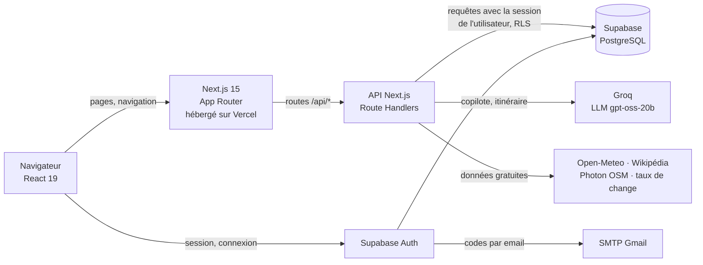
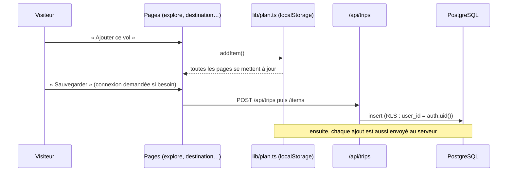
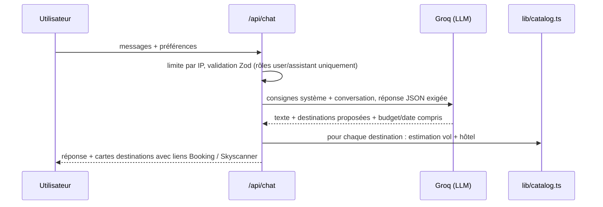
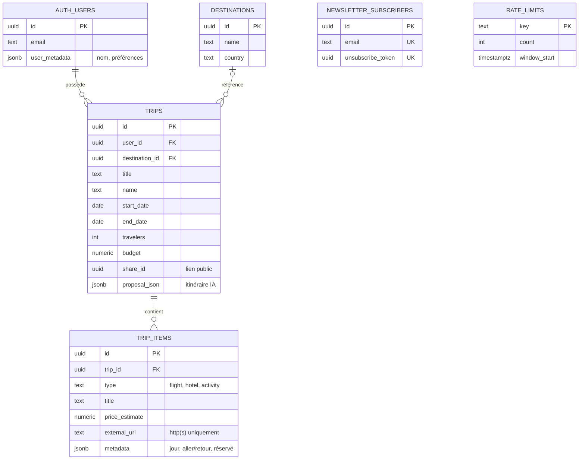
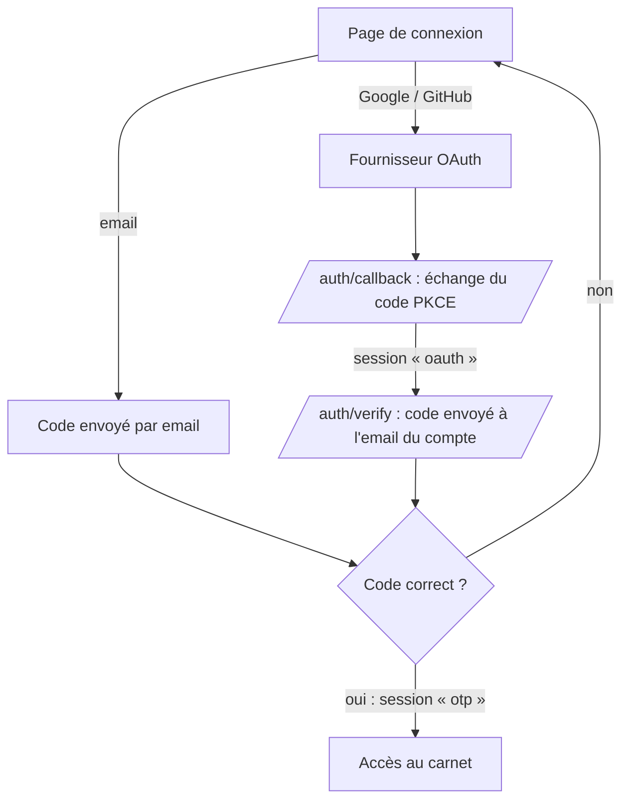

# Architecture d'AIVANA

Ce document explique comment le code est organisé et pourquoi. Il se lit en 10 minutes et
permet de retrouver n'importe quelle fonctionnalité dans le dépôt.

## 1. Vue d'ensemble



Une seule application **Next.js** contient à la fois l'interface (pages React) et le back-end
(routes `/api/*`). **Supabase** fournit la base PostgreSQL, l'authentification et la sécurité
par ligne (RLS). **Groq** exécute le modèle de langage du copilote.

| Couche | Technologie | Rôle |
|---|---|---|
| Interface | React 19, Next.js 15 (App Router), Tailwind CSS | Pages, composants, navigation |
| Back-end | Route Handlers Next.js (`src/app/api`) | Validation, règles métier, appels externes |
| Base de données | PostgreSQL (Supabase) + RLS | Voyages, éléments, newsletter, compteurs anti-abus |
| Authentification | Supabase Auth | Code par email, Google, GitHub, double authentification |
| IA | Groq (`openai/gpt-oss-20b`) | Copilote conversationnel, génération d'itinéraire |
| Validation | Zod | Schéma de chaque entrée d'API |
| Qualité | TypeScript strict, ESLint, Prettier, Jest, GitHub Actions | Voir §7 |

## 2. Organisation des dossiers

```
frontend/
├── src/
│   ├── app/                      ROUTES (une URL = un dossier)
│   │   ├── page.tsx              Accueil
│   │   ├── explore/              Destinations, vols, hôtels, activités
│   │   ├── destination/[id]/     Fiche d'une destination (météo, change, lieux, budget)
│   │   ├── assistant/            Copilote IA en plein écran
│   │   ├── dashboard/            Carnet de voyage (page) → composants dans components/dashboard
│   │   ├── carnet/               Version imprimable / PDF du voyage
│   │   ├── voyage/[shareId]/     Page publique d'un voyage partagé (lecture seule)
│   │   ├── auth/                 Connexion (login), 2e facteur (verify), retour OAuth (callback)
│   │   ├── onboarding/           Préférences du voyageur à la 1re connexion
│   │   ├── blog/ aide/ contact/ legal/ newsletter/ credits/
│   │   └── api/                  BACK-END (voir §4)
│   ├── components/               COMPOSANTS RÉUTILISABLES, rangés par domaine
│   │   ├── layout/               Navbar, Footer, ClientShell, gardes de navigation
│   │   ├── dashboard/            Morceaux du carnet (TripDashboard, NextSteps, Settings…)
│   │   ├── trip/                 Itinéraire IA, conseils voyageurs, barre de voyage
│   │   ├── chat/                 Fenêtre du copilote (ChatDock)
│   │   ├── account/              Sécurité du compte et RGPD
│   │   └── ui/                   Briques visuelles (Logo, Photo, Pill, Turnstile…)
│   ├── lib/                      LOGIQUE SANS INTERFACE (testable)
│   │   ├── api/                  Garde d'accès, limitation de requêtes, captcha
│   │   ├── supabase/             Clients Supabase (navigateur, serveur, admin)
│   │   ├── ai/ + agents/         Appel à Groq, extraction JSON, agent d'itinéraire
│   │   ├── travel/ + world/      Compagnies aériennes, hébergements, conseils, villes
│   │   ├── catalog.ts            81 destinations, 36 pays : estimations de budget
│   │   ├── plan.ts               « Voyage en cours » partagé entre les pages
│   │   └── *.test.ts             Tests unitaires à côté du code testé
│   ├── types/                    Types TypeScript partagés
│   └── middleware.ts             Rafraîchissement de la session à chaque page
├── supabase/
│   ├── setup.sql                 Installation complète d'un projet Supabase vide
│   └── migrations/0001…0008      Historique des évolutions du schéma
├── eslint.config.mjs · .prettierrc.json · jest.config.js · tsconfig.json
└── Dockerfile                    Image de production (alternative à Vercel)
```

**Règle de rangement** : `app/` décrit *les URL*, `components/` *l'affichage*, `lib/` *la logique*.
Une fonction de calcul (budget, nuits, prix estimé) est dans `lib/` et testée ; un composant ne
fait qu'afficher et appeler ces fonctions.

## 3. Le « voyage en cours » (état côté client)

Le visiteur peut composer un voyage **sans compte**. Le voyage est stocké dans le navigateur
(`localStorage`) et partagé entre toutes les pages par un petit store (`lib/plan.ts`) basé sur
`useSyncExternalStore` de React : pas besoin de Redux ni de Context global.



## 4. Le back-end (routes `/api`)

| Route | Méthodes | Accès | Rôle |
|---|---|---|---|
| `/api/trips` | GET, POST | connecté + code email | Lister / créer ses voyages |
| `/api/trips/[tripId]` | GET, PATCH, DELETE | idem | Lire / modifier / supprimer un voyage |
| `/api/trips/[tripId]/items` | GET, POST | idem | Éléments d'un voyage (vol, hôtel, activité) |
| `/api/trips/[tripId]/items/[itemId]` | PATCH, DELETE | idem | Placer un élément un jour, marquer « réservé » |
| `/api/trips/[tripId]/proposal` | GET, POST | idem | Itinéraire jour par jour généré par l'IA |
| `/api/trips/[tripId]/share` | POST, DELETE | idem | Activer / couper le lien public |
| `/api/account` | DELETE | idem | Suppression du compte (RGPD) |
| `/api/account/export` | GET | idem | Export JSON des données (RGPD) |
| `/api/chat` | POST | public, limité par IP | Copilote conversationnel |
| `/api/partner/*/search` | GET | public, limité par IP | Recherche de vols, hôtels, activités, villes |
| `/api/destination-info` | GET | public, limité par IP | Météo, taux de change, lieux à voir |
| `/api/newsletter` | POST, DELETE | public + captcha | Inscription / désinscription |

Chaque route privée suit le même schéma, toujours dans cet ordre :

```ts
export async function POST(request: Request, { params }: Ctx) {
  const { tripId } = await params;
  if (!isUuid(tripId)) return notFound();                 // 1. paramètres d'URL valides
  const g = await requireUser();                          // 2. utilisateur + code email vérifiés
  if (!g.ok) return g.response;
  if (!(await rateLimit(`…:${g.user.id}`, 30, 3600)))     // 3. anti-abus
    return tooManyRequests(3600);
  const parsed = schema.safeParse(await request.json());  // 4. corps validé par Zod
  if (!parsed.success) return badRequest();
  const { data, error } = await g.supabase.from(…)…;      // 5. requête avec la session (RLS)
  if (error) return serverError("contexte", error);       // 6. erreur générique, détail en logs
  return NextResponse.json(data);
}
```

### Le copilote IA



Le modèle ne donne **jamais** de prix : ils sont calculés par notre code à partir du catalogue et
affichés comme « estimés ». Ça évite qu'une IA invente des tarifs.

## 5. Base de données



- Suppression d'un compte ⇒ suppression en cascade des voyages puis des éléments (`ON DELETE CASCADE`).
- **RLS** sur toutes les tables : un utilisateur ne voit que ses lignes, et seulement si sa session a été
  validée par un code email (policy restrictive, migration 0008).
- Les migrations sont **numérotées et ré-exécutables** (`IF NOT EXISTS`, `DROP … IF EXISTS`).

## 6. Authentification



La méthode de connexion est inscrite par Supabase dans le jeton signé (champ `amr`). L'API
(`lib/api/guard.ts`) et la base (`session_email_verified()`) refusent toute session qui n'a pas
été validée par un code email. Détails dans [SECURITE.md](../SECURITE.md).

## 7. Qualité du code

| Outil | Commande | Ce qu'il garantit |
|---|---|---|
| TypeScript (mode `strict`) | `npm run typecheck` | Aucune erreur de type, pas de `any` |
| ESLint (règles Next.js + TS) | `npm run lint` | Bonnes pratiques React, hooks, accessibilité |
| Prettier | `npm run format:check` | Formatage identique dans tout le projet |
| Jest (9 suites, 111 tests) | `npm test` | Calculs de budget, vols, itinéraire, sécurité |
| Tout d'un coup | `npm run check` | Les quatre ci-dessus |
| GitHub Actions | à chaque push | Les mêmes vérifications + audit des dépendances + build |

Conventions :
- **Commits** au format *Conventional Commits* (`feat:`, `fix:`, `refactor:`, `docs:`, `chore:`).
- **Commentaires en français**, qui expliquent le *pourquoi* plutôt que le *quoi*.
- Composants en `PascalCase.tsx`, logique en `camelCase.ts`, tests `*.test.ts` à côté du fichier testé.
- Aucun secret dans le code : variables d'environnement (`.env.example` documente la liste).

## 8. Lancer le projet

```bash
cd frontend
npm install
cp .env.example .env.local   # puis remplir les clés Supabase et Groq
npm run dev                  # http://localhost:3000
```

Base de données : coller `frontend/supabase/setup.sql` dans le SQL Editor de Supabase.
