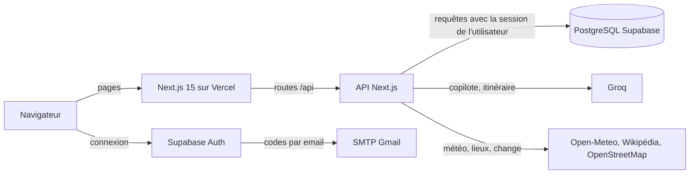
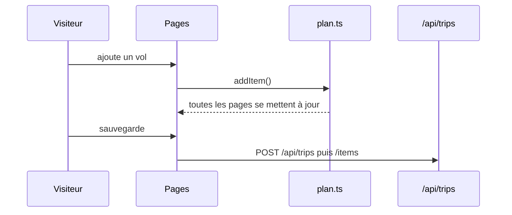
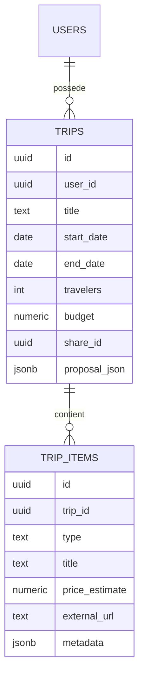
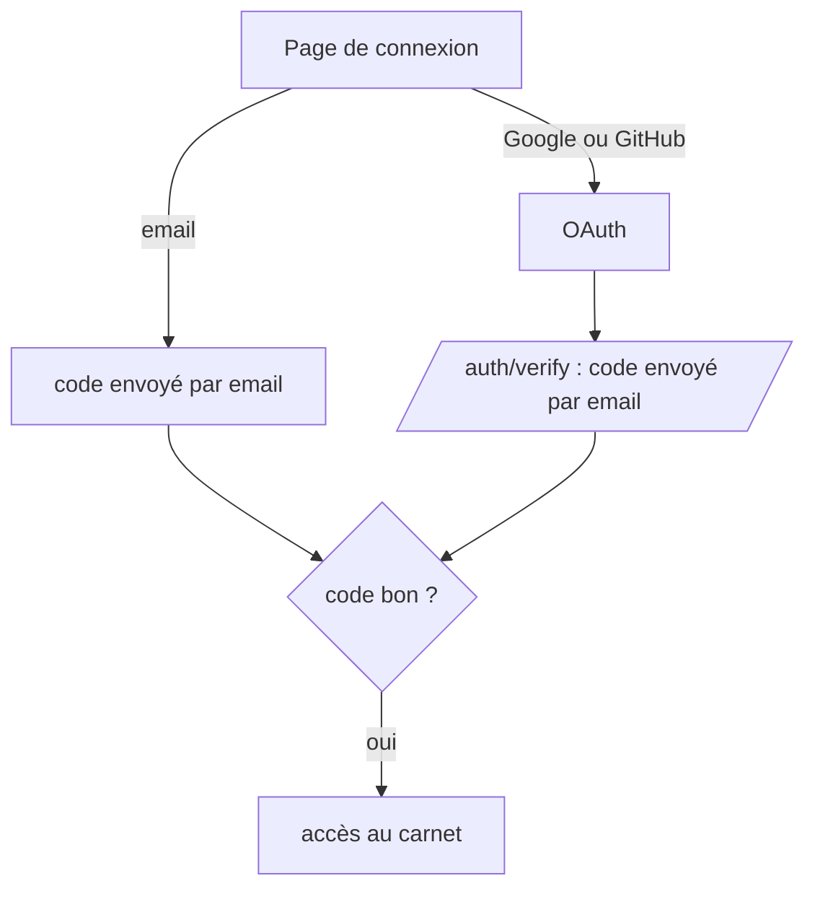

# Architecture

Ici j'explique comment le projet est construit et pourquoi j'ai fait ces choix. 
Si vous cherchez où se trouve une fonctionnalité dans le code, c'est le bon endroit pour commencer.

## Vue d'ensemble



Tout tient dans une seule application Next.js : les pages en React et le back-end dans `src/app/api`.
Pour la base de données et les comptes j'utilise Supabase (PostgreSQL + Auth), et pour l'IA, Groq.

Au début du projet ce n'était pas du tout ça. J'étais parti sur des microservices (auth, IA, base,
partenaires, une API gateway, Redis...), neuf services en tout, déployés sur Render. Ça marchait en local
mais en production c'était pénible : l'offre gratuite limite le nombre de services, chaque service mettait
du temps à se réveiller, et quand un tombait les autres suivaient. J'ai d'abord tout regroupé en un
monolithe, puis je suis passé sur Next.js + Supabase. Avec le recul c'était le bon choix pour un projet que
je fais seul : moins d'infra à gérer, et je peux me concentrer sur le produit.

Les technos utilisées :

- **Next.js 15 / React 19** : le front et l'API dans le même projet, déploiement automatique sur Vercel.
- **TypeScript** en mode strict.
- **Tailwind CSS** : les couleurs de la charte (`ink`, `gold`, `paper`...) sont définies une seule fois
  dans `tailwind.config.js`.
- **Supabase** : PostgreSQL, l'authentification (code par email, Google, GitHub) et la RLS.
- **Groq** avec le modèle `openai/gpt-oss-20b` pour le copilote.
- **Zod** pour valider tout ce qui arrive dans l'API.

## Les dossiers

```
frontend/
├── src/
│   ├── app/                 les pages et l'API (un dossier = une URL)
│   │   ├── explore/         destinations, vols, hôtels, activités
│   │   ├── destination/[id] fiche d'une destination
│   │   ├── dashboard/       le carnet de voyage
│   │   ├── carnet/          version imprimable du voyage
│   │   ├── voyage/[shareId] page publique d'un voyage partagé
│   │   ├── auth/            connexion, vérification par code, retour OAuth
│   │   └── api/             le back-end
│   ├── components/          les composants, rangés par thème
│   │   ├── dashboard/       les morceaux du carnet
│   │   ├── layout/          navbar, footer...
│   │   ├── trip/ chat/ account/ ui/
│   ├── lib/                 la logique (calculs, appels externes, sécurité) + les tests
│   ├── types/               les types partagés
│   └── middleware.ts        rafraîchit la session à chaque page
└── supabase/
    ├── setup.sql            pour installer la base d'un coup
    └── migrations/          l'historique du schéma (0001 à 0008)
```

La règle que j'essaie de suivre : `app/` pour les URL, `components/` pour l'affichage, `lib/` pour la
logique. Les calculs (budget, nombre de nuits, prix estimés...) sont dans `lib/` pour pouvoir les tester
sans interface. Par exemple le carnet faisait plus de 700 lignes dans un seul fichier, je l'ai découpé en
composants dans `components/dashboard/` et la page fait maintenant 157 lignes.

## Le voyage en cours

Un truc que je voulais absolument : pouvoir préparer un voyage sans créer de compte. Le voyage en cours
est donc gardé dans le navigateur (`localStorage`) et toutes les pages le lisent via `src/lib/plan.ts`.
J'utilise le hook `useSyncExternalStore` de React, ça évite d'installer Redux pour un état aussi simple, et
ça se synchronise même entre deux onglets.

Quand l'utilisateur sauvegarde (et là on lui demande de se connecter), le voyage est créé en base et chaque
ajout suivant est aussi envoyé au serveur.



## L'API

Les routes principales :

| Route | Rôle |
|---|---|
| `/api/trips` | lister et créer ses voyages |
| `/api/trips/[tripId]` | lire, modifier, supprimer un voyage |
| `/api/trips/[tripId]/items` | ajouter des vols, hôtels, activités |
| `/api/trips/[tripId]/proposal` | itinéraire jour par jour généré par l'IA |
| `/api/trips/[tripId]/share` | activer ou couper le lien de partage |
| `/api/account` et `/api/account/export` | suppression du compte et export des données |
| `/api/chat` | le copilote (ouvert sans compte, mais limité) |
| `/api/partner/...` et `/api/destination-info` | recherches et infos des fiches |
| `/api/newsletter` | inscription et désinscription |

Toutes les routes privées sont écrites de la même façon, ça m'évite d'oublier une vérification :

```ts
const { tripId } = await params;
if (!isUuid(tripId)) return notFound();          // l'id doit être un UUID
const g = await requireUser();                   // utilisateur connecté + code email validé
if (!g.ok) return g.response;
const parsed = schema.safeParse(await request.json()); // le corps est validé avec Zod
if (!parsed.success) return badRequest();
const { data, error } = await g.supabase.from("trips")...; // la RLS s'applique
if (error) return serverError("contexte", error); // message générique, détail dans les logs
```

`requireUser()` est dans `src/lib/api/guard.ts`.

### Le copilote

Le copilote envoie la conversation à Groq en demandant une réponse en JSON (texte, budget compris, date,
destinations proposées). Par contre je ne laisse jamais l'IA donner des prix : elle a tendance à en inventer.
Les prix sont calculés par mon code à partir du catalogue (`estimate()` dans `lib/catalog.ts`) et affichés
comme des estimations, avec un lien vers le vrai site (Booking, Skyscanner...).

Pour l'itinéraire du carnet, `lib/agents/roadtripAgent.ts` demande un programme jour par jour et nettoie la
réponse si le modèle oublie des champs. En juin j'avais fait une version avec plusieurs agents (destination,
transport, budget...) mais c'était lent et ça consommait beaucoup de quota, donc je suis revenu à un seul
appel bien structuré.

## La base de données



Un utilisateur a des voyages, un voyage a des éléments (vol, hôtel ou activité). Les infos qui changent selon
le type d'élément (le jour où il est placé, aller ou retour, réservé ou non) sont dans une colonne JSONB
`metadata`, ça évite d'avoir plein de colonnes vides. Si on supprime un compte, ses voyages et leurs éléments
partent avec (`ON DELETE CASCADE`).

Il y a aussi `newsletter_subscribers` et `rate_limits` (le compteur anti-abus). La RLS est activée sur toutes
les tables, j'en parle plus en détail dans [SECURITE.md](../SECURITE.md).

## La connexion

On peut se connecter avec un code reçu par email, ou avec Google / GitHub. Dans ce deuxième cas, on demande
quand même un code par email après : c'est la double authentification.



## Qualité

- `npm run check` lance tout : TypeScript, ESLint, Prettier et les tests Jest (111 tests).
- La même chose tourne sur GitHub Actions à chaque push, avec en plus un `npm audit` et un build.
- Les messages de commit suivent la convention `feat:`, `fix:`, `refactor:`, `docs:`...
- Les commentaires dans le code sont en français et expliquent surtout pourquoi je fais les choses.

## Lancer le projet

```bash
cd frontend
npm install
cp .env.example .env.local   # mettre les clés Supabase et Groq
npm run dev
```

Pour la base : coller `frontend/supabase/setup.sql` dans le SQL Editor de Supabase.
