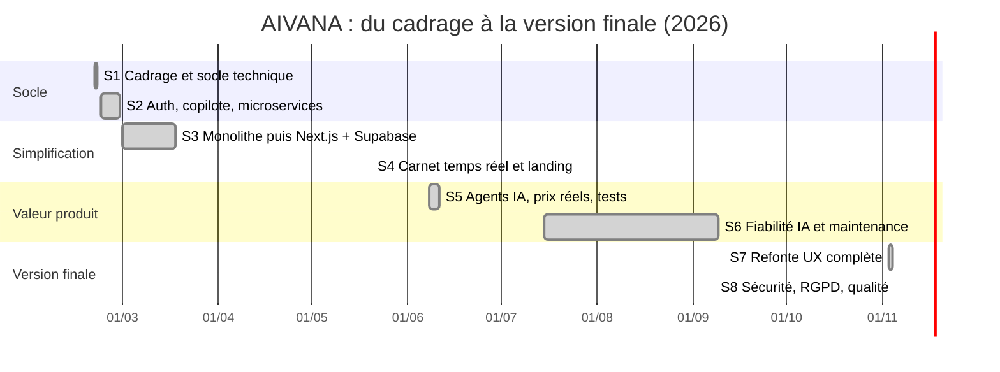

# Pilotage du projet AIVANA

## 1. Méthode

Projet mené seul, en **méthode agile inspirée de Scrum**, adaptée à un développeur unique :

- **Sprints courts** (de 2 jours à 2 semaines selon la disponibilité), chacun avec un objectif clair
  et une version qui fonctionne à la fin.
- **Backlog priorisé** dans Notion (méthode MoSCoW : *Must, Should, Could, Won't*).
- **Tableau Kanban** : Backlog → À faire → En cours → En revue → Terminé.
- **Définition de « Terminé »** : la fonctionnalité marche en local, le build passe, le code est
  commité sur GitHub avec un message clair, et elle est déployée.
- **Rituels** (en solo, mais tenus) :
  - *planification* en début de sprint : choix des tickets, estimation en points (1, 2, 3, 5, 8) ;
  - *revue* en fin de sprint : démonstration de la version, captures d'écran dans Notion ;
  - *rétrospective* : ce qui a marché, ce qui a bloqué, une action d'amélioration pour le sprint suivant.

## 2. Outils

| Outil | Usage |
|---|---|
| **Notion** | Base « Backlog » (tickets), vues Kanban, Calendrier/Timeline et « par sprint », journal des décisions |
| **GitHub** | Code source, historique (plus de 280 commits), branches (`main`, `refonte-ui`), intégration continue |
| **GitHub Actions** | Vérification automatique à chaque push : types, lint, formatage, tests, audit, build |
| **Vercel** | Déploiement continu du site |
| **Supabase** | Base de données, authentification, journaux (logs) pour le diagnostic |

Le fichier [pilotage/backlog-notion.csv](pilotage/backlog-notion.csv) contient le backlog complet :
il s'importe directement dans Notion (*Importer → CSV*) ou dans Jira (*Importer des tickets → CSV*).
Chaque ticket indique le sprint, les dates, l'estimation et le commit correspondant.

### Structure de la base Notion « Backlog »

| Propriété | Type | Valeurs |
|---|---|---|
| Titre | Titre | « Connexion par code email » |
| Type | Sélection | Epic, Story, Tâche, Bug |
| Epic | Sélection | Socle, Authentification, Copilote IA, Recherche voyage, Carnet, UX/UI, Données, Sécurité, Qualité, Déploiement |
| Sprint | Sélection | S1 … S8 |
| Statut | Statut | Backlog, À faire, En cours, En revue, Terminé |
| Priorité | Sélection | Must, Should, Could |
| Points | Nombre | 1, 2, 3, 5, 8 |
| Début / Fin | Date | |
| Critères d'acceptation | Texte | ce qui doit être vrai pour que ce soit terminé |
| Commit | Texte | message du commit qui livre le ticket |

## 3. Déroulé du projet (sprints)

| Sprint | Dates | Objectif | Livré |
|---|---|---|---|
| **S1** Cadrage et socle | 20–21 fév. | Poser l'architecture et une première interface | Projet initial, base PostgreSQL, premiers écrans, page Explorer |
| **S2** Fonctionnalités cœur | 22–28 fév. | Comptes, copilote IA, déploiement | Auth (email, Google, Microsoft), chatbot, API Gateway, 9 microservices sur Render, intégrations vols/hôtels/activités |
| **S3** Simplification | 1–18 mars | Rendre le projet fiable et déployable gratuitement | Microservices → monolithe, puis Next.js + Supabase (Auth, RLS), vraies API de recherche |
| **S4** Carnet | 20 mai | Un carnet de voyage utile | Carnet en temps réel, sauvegarde fiable, page d'accueil orientée pitch |
| **S5** IA et données | 8–11 juin | Valeur métier | Pipeline d'agents IA, prix réels, types centralisés, tests Jest, rapport technique |
| **S6** Fiabilité | juil.–sept. | Tenir dans la durée | Suivi d'audience, remplacement des modèles IA retirés par Groq, corrections de prix, support de présentation |
| **S7** Refonte UX | 3–4 nov. | Un parcours clair et cohérent | Nouvelle charte, toutes les pages refaites depuis les maquettes, 81 destinations, PDF du voyage, partage public |
| **S8** Sécurité et qualité | 5 nov. | Prêt pour la production | Next.js 15, double authentification par email, RGPD, anti-abus, CSP, lint/format, CI |

## 4. Journal des décisions

| # | Date | Décision | Pourquoi | Conséquence |
|---|---|---|---|---|
| D1 | 21 fév. | OpenAI → Google Gemini → **Groq** (23 fév.) | Quota OpenAI épuisé et payant ; Groq a une offre gratuite et répond très vite | Couche `lib/ai/groq.ts` isolée : changer de modèle = changer une ligne |
| D2 | 24 fév. | Architecture **microservices** (auth, IA, base, partenaires, gateway…) | Objectif d'apprentissage, séparation des responsabilités | 9 services à déployer, beaucoup de configuration réseau |
| D3 | 1 mars | Microservices → **monolithe** | L'offre gratuite de Render limite le nombre de services ; démarrages lents, pannes en cascade | Déploiement simplifié, un seul service |
| D4 | 16 mars | Monolithe → **Next.js + Supabase** | Supabase fournit PostgreSQL + Auth + RLS sans serveur à maintenir ; Vercel déploie Next.js gratuitement | Moins de code d'infrastructure, sécurité au niveau de la base |
| D5 | 8 juin | Prix « réels » via catalogue | Les API de prix gratuites ont fermé (Amadeus, juillet 2026) | Prix affichés comme **estimés**, liens vers les sites de réservation |
| D6 | 28 août | Modèle IA `openai/gpt-oss-20b` | Les modèles précédents ont été retirés par Groq | Sortie JSON native, plus fiable |
| D7 | 3 nov. | Refonte complète de l'interface | Parcours trop dispersé, charte incohérente | Parcours unique : idée → destination → vols/hôtels/activités → carnet |
| D8 | 5 nov. | Next.js 14 → **15** | Failles critiques sur la 14 (non corrigées) | Migration de `params`/`cookies()` en asynchrone, React 19 |
| D9 | 5 nov. | 2FA par **code email** plutôt que TOTP (QR code) | Plus simple pour l'utilisateur, aucune application à installer | Gmail SMTP configuré, règle imposée jusque dans la base |

## 5. Risques suivis

| Risque | Probabilité | Impact | Réponse |
|---|---|---|---|
| Fermeture ou changement d'une API gratuite | Élevée (arrivé 2 fois) | Moyen | Fournisseurs isolés dans `lib/`, solutions de repli (liste statique, estimation) |
| Retrait d'un modèle IA | Élevée (arrivé 2 fois) | Élevé | Un seul point d'appel (`groq.ts`), messages d'erreur clairs, réessai |
| Limites des offres gratuites (Render, emails) | Moyenne | Moyen | Simplification de l'architecture (D3, D4), SMTP Gmail |
| Faille de sécurité | Moyenne | Élevé | Audit, RLS, CI avec `npm audit`, en-têtes HTTP (voir SECURITE.md) |
| Manque de temps (projet en solo) | Élevée | Élevé | Priorisation MoSCoW, sprints courts, version fonctionnelle à chaque fin de sprint |

## 6. Indicateurs

- **Plus de 280 commits** sur GitHub, messages au format *Conventional Commits*.
- **111 tests automatisés** (9 suites), exécutés à chaque push.
- **0 vulnérabilité** connue dans les dépendances de production (`npm audit`).
- **0 erreur** TypeScript et ESLint.
- **81 destinations** dans 36 pays.

## 7. Rétrospective générale

- **Ce qui a bien marché** : livrer une version fonctionnelle à chaque sprint ; isoler les services
  externes (IA, données) pour pouvoir les remplacer sans tout casser.
- **Ce qui a été difficile** : l'architecture microservices était trop lourde pour un projet solo
  hébergé gratuitement. La simplifier (D3, D4) a été la décision la plus utile du projet.
- **Ce que je referais autrement** : écrire les tests et la CI dès le premier sprint, et faire un
  audit de sécurité plus tôt plutôt qu'en fin de projet.
