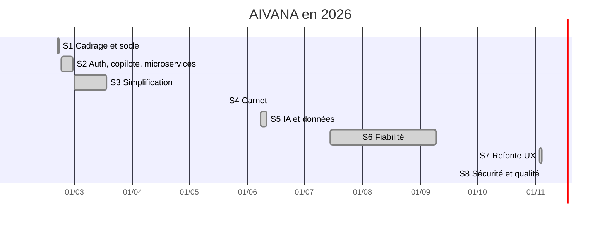

# Pilotage du projet

## Comment j'ai organisé le travail

J'ai fait le projet seul, donc j'ai repris les principes de Scrum en les adaptant. Je travaillais par sprints
(de quelques jours à deux semaines selon mes disponibilités), avec à chaque fois un objectif précis et une
version qui marche à la fin du sprint.

Le suivi est dans Notion :

- un backlog avec toutes les tâches, priorisées en MoSCoW (Must, Should, Could, Won't) ;
- une vue Kanban : Backlog, À faire, En cours, En revue, Terminé ;
- une vue chronologique pour voir les sprints dans le temps ;
- les tâches estimées en points (1, 2, 3, 5, 8), surtout pour repérer celles qui étaient trop grosses et les découper.

Pour moi une tâche est terminée quand elle marche en local, que le build passe, qu'elle est commitée sur GitHub
avec un message clair et qu'elle est en ligne.

En début de sprint je choisissais les tâches, et à la fin je faisais le point : ce qui a marché, ce qui a
bloqué, et ce que je change pour le sprint suivant.

Le backlog complet est dans [pilotage/backlog-notion.csv](pilotage/backlog-notion.csv) (import direct dans
Notion ou Jira). Chaque tâche indique le commit qui la livre, donc on peut retrouver le code correspondant
dans l'historique GitHub.

Les autres outils :

- **GitHub** pour le code et l'historique (plus de 280 commits) ;
- **GitHub Actions** pour vérifier le code automatiquement à chaque push ;
- **Vercel** pour le déploiement ;
- **Supabase** pour la base, les comptes, et les logs quand il faut débugger.

## Les sprints

**S1 - Cadrage et socle (20-21 février).** Mise en place du projet, de la base PostgreSQL, des premiers écrans
et de la page Explorer.

**S2 - Les fonctionnalités principales (22-28 février).** Comptes (email, Google, Microsoft), premier chatbot,
API gateway, déploiement des 9 microservices sur Render, recherche de vols, d'hôtels et d'activités.

**S3 - Simplification (1er-18 mars).** Les microservices posaient trop de problèmes en production. Je les ai
regroupés en un monolithe, puis je suis passé sur Next.js + Supabase.

**S4 - Le carnet (20 mai).** Carnet mis à jour en temps réel, sauvegarde des voyages fiable, nouvelle page
d'accueil.

**S5 - IA et données (8-11 juin).** Agents IA pour construire un voyage, vrais prix au lieu de prix inventés,
types regroupés dans `src/types`, premiers tests Jest.

**S6 - Fiabilité (juillet à septembre).** Plutôt de la maintenance : statistiques de visite, changement de
modèle IA quand Groq a retiré ceux que j'utilisais, corrections sur les prix des hôtels.

**S7 - Refonte UX (3-4 novembre).** Nouvelle charte graphique, toutes les pages refaites à partir des maquettes
pour avoir un vrai parcours, 81 destinations, PDF du voyage, partage par lien.

**S8 - Sécurité et qualité (5 novembre).** Audit de sécurité, passage à Next.js 15, double authentification par
email, droits RGPD, limitation des requêtes, ESLint, Prettier et intégration continue.

Entre mars et mai, puis pendant l'été, j'ai moins avancé sur le projet. Comme chaque sprint se terminait avec
une version qui fonctionne, j'ai pu reprendre facilement à chaque fois.

## Les décisions importantes

| Date | Décision | Pourquoi |
|---|---|---|
| 21-23 fév. | OpenAI → Gemini → Groq | Plus de quota sur OpenAI. Groq est gratuit et très rapide. L'appel est isolé dans `lib/ai/groq.ts`, donc changer de fournisseur ne touche pas au reste. |
| 24 fév. | Partir sur des microservices | Je voulais apprendre cette architecture et bien séparer les responsabilités. |
| 1er mars | Tout regrouper en monolithe | Limites de l'offre gratuite de Render, services lents à démarrer, pannes en cascade. |
| 16 mars | Passer sur Next.js + Supabase | Base, comptes et sécurité (RLS) sans serveur à gérer, déploiement gratuit sur Vercel. |
| 8 juin | Prix estimés à partir d'un catalogue | Les API de prix gratuites ont fermé (Amadeus en juillet 2026). Je préfère afficher une estimation honnête qu'un faux prix. |
| 28 août | Modèle `openai/gpt-oss-20b` | Les modèles d'avant ont été retirés par Groq. Celui-ci renvoie du JSON de façon plus fiable. |
| 3 nov. | Refaire toute l'interface | Le site était devenu trop dispersé, on ne comprenait pas le parcours. |
| 5 nov. | Next.js 14 → 15 | `npm audit` montrait des failles critiques sur la version 14. |
| 5 nov. | 2FA par code email plutôt qu'avec une application | J'avais commencé avec un QR code (TOTP), mais c'était trop compliqué pour l'utilisateur. Un code par email ne demande rien à installer. |

## Les risques que j'avais identifiés

- **Une API gratuite qui ferme ou change.** C'est arrivé deux fois. Chaque service externe est isolé dans `lib/`
  et a une solution de repli (liste statique, estimation), donc le site continue de marcher.
- **Un modèle d'IA retiré.** Arrivé deux fois aussi. Il n'y a qu'un seul endroit où l'IA est appelée, ça se
  corrige vite.
- **Les limites des offres gratuites** (Render, puis l'envoi d'emails de Supabase). Réglé en simplifiant
  l'architecture et en passant par mon propre SMTP Gmail.
- **Une faille de sécurité.** Audit complet, RLS sur toutes les tables, `npm audit` dans la CI.
- **Le manque de temps**, vu que je suis seul. D'où la priorisation MoSCoW et les sprints courts.

## Où en est le projet

- plus de 280 commits ;
- 111 tests automatisés qui passent ;
- 0 vulnérabilité connue dans les dépendances de production ;
- 0 erreur TypeScript et ESLint ;
- 81 destinations dans 36 pays.

## Bilan

Ce qui a bien marché : avoir une version qui fonctionne à chaque fin de sprint, et avoir isolé les services
externes, ce qui m'a sauvé plusieurs fois.

Ce qui a été difficile : les microservices. J'y ai passé beaucoup de temps pour un résultat fragile. Revenir à
quelque chose de plus simple a été la décision la plus utile du projet.

Ce que je ferais différemment : mettre en place les tests, la CI et la sécurité dès le début, au lieu de m'en
occuper à la fin.
